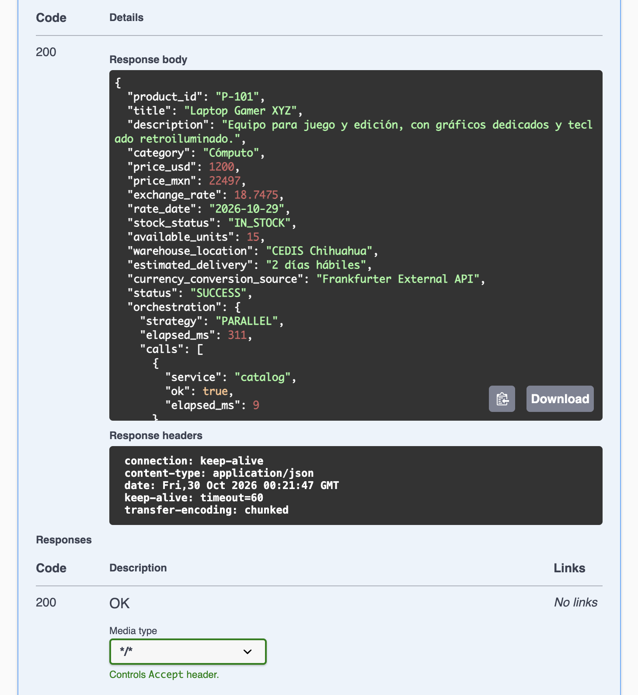
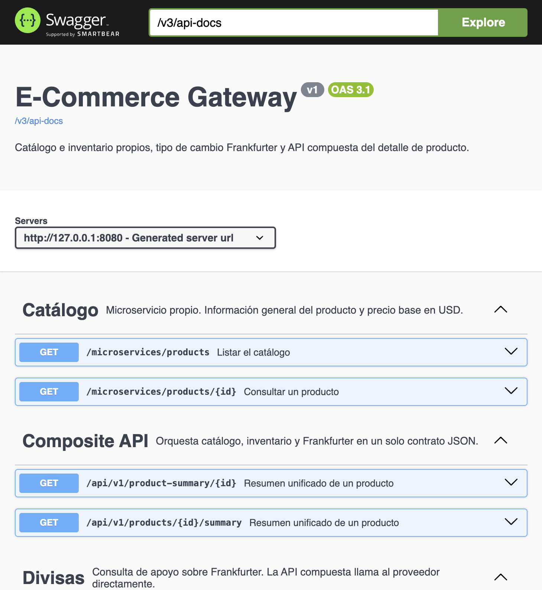
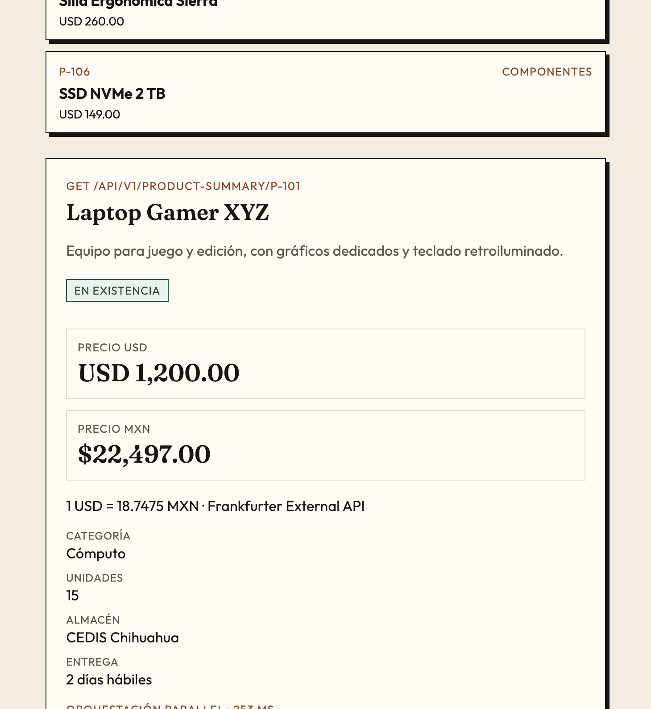
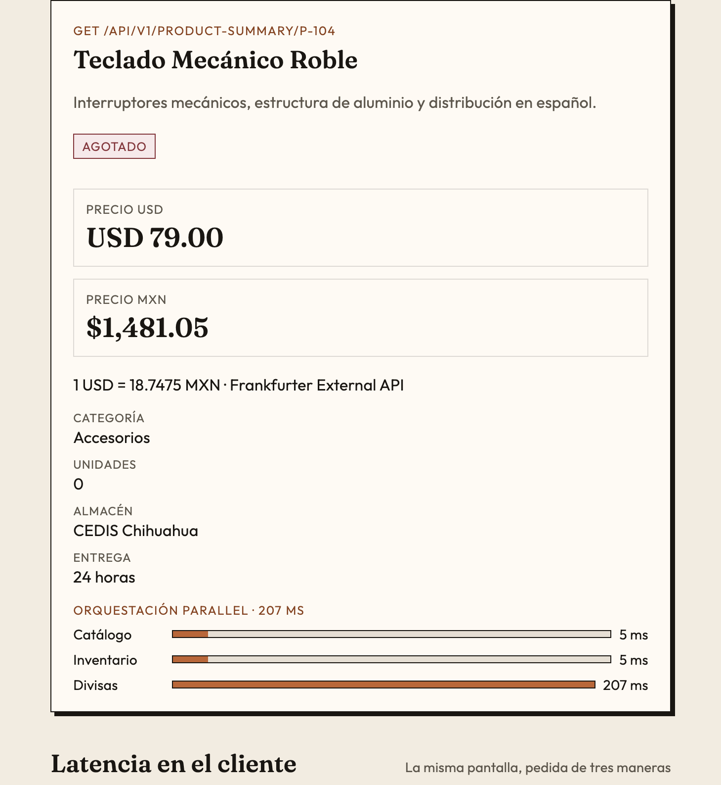
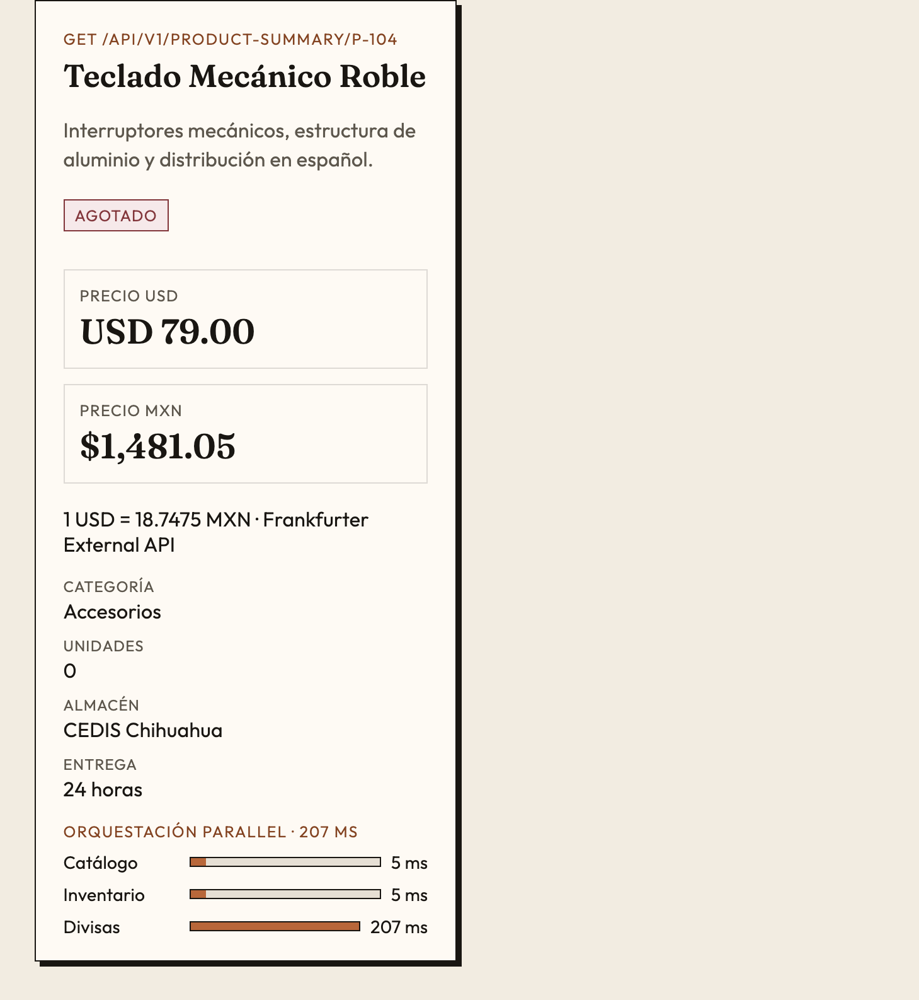

# Reporte técnico

## 1. Portada institucional

| | |
| --- | --- |
| Institución | Universidad Tecnológica de Chihuahua (UTCH) |
| Programa educativo | Desarrollo y Gestión de Software |
| Asignatura | Desarrollo Web Integral — Unidad 3 |
| Práctica | Implementación de Composite API y consumo de microservicios |
| Alumno | **(completar nombre)** |
| Grupo | **(completar grupo)** |
| Fecha | 29 de octubre de 2026 |

## 2. Introducción y caso de estudio

La pantalla de detalle de un producto, hecha con peticiones sueltas, obliga al navegador a conocer tres contratos: el catálogo, el inventario y el tipo de cambio. Eso es el problema que se conoce como *chatty I/O*: muchas idas y vueltas por la red, más puntos de fallo y un cliente acoplado a servicios que no debería orquestar.

Una Composite API (o API agregadora) es un solo endpoint que habla con esos servicios y devuelve un JSON ya unido. El cliente pide el resumen una vez. El servidor hace las consultas, en este proyecto en paralelo, convierte el precio y responde con un contrato estable. Si más adelante cambia la URL de Frankfurter o la forma del inventario, se ajusta el gateway y no cada pantalla.

## 3. Especificación técnica

| Microservicio / API | Tipo | Protocolo / formato | Endpoint / URL base | Descripción y función |
| --- | --- | --- | --- | --- |
| 1. Catálogo | Propia | REST / JSON | `GET /microservices/products/{id}` | Nombre, descripción, categoría y precio base en USD. Tabla `catalog.products`. |
| 2. Inventario | Propia | REST / JSON | `GET /microservices/inventory/{productId}` | Unidades, estado de stock, almacén y entrega estimada. Tabla `inventory.stock`. |
| 3. Divisas | Terceros (Frankfurter) | REST / JSON | `https://api.frankfurter.app/latest?from=USD&to=MXN` | Tasa USD/MXN del día. Hoy esa URL responde 301 hacia `https://api.frankfurter.dev/v1/latest`. |
| 4. Composite API | Propia (agregadora) | REST / JSON | `GET /api/v1/product-summary/{id}` | Orquesta las tres fuentes y entrega el contrato unificado. Alias: `GET /api/v1/products/{id}/summary`. |

Hay un endpoint de apoyo, `GET /microservices/currency/usd-mxn`. No es un cuarto microservicio de negocio: usa el mismo cliente de Frankfurter para que Swagger y el tablero puedan mostrar la tasa sin llamar al proveedor desde el navegador. La API compuesta no pasa por ese endpoint; llama a Frankfurter directo.

Catálogo e inventario no tienen llave foránea entre sí. Comparten el `product_id` como dato de correlación. En la práctica viven en dos esquemas de la misma base PostgreSQL para poder entregar un solo proceso. En un despliegue real cada uno tendría su propia base.

Estados de inventario:

- `IN_STOCK`: más de 10 unidades
- `LOW_STOCK`: de 1 a 10
- `OUT_OF_STOCK`: 0
- `UNAVAILABLE`: el inventario no respondió

## 4. Implementación y orquestación

El consumo es **paralelo**. `ProductSummaryService` dispara las tres llamadas con `CompletableFuture.supplyAsync` sobre un pool propio (`upstream-`) y espera con `CompletableFuture.allOf`. El tiempo total se acerca al de la llamada más lenta, no a la suma de las tres.

```java
CompletableFuture<CallOutcome<ProductResponse>> productCall =
        dispatch("catalog", () -> catalogHttpClient.getById(productId));
CompletableFuture<CallOutcome<InventoryResponse>> inventoryCall =
        dispatch("inventory", () -> inventoryHttpClient.getByProductId(productId));
CompletableFuture<CallOutcome<ExchangeQuote>> currencyCall =
        dispatch("currency", frankfurterClient::latestUsdToMxn);

CompletableFuture.allOf(productCall, inventoryCall, currencyCall).join();
```

El controlador regresa un `Callable`. Spring lo ejecuta fuera del hilo de Tomcat. Hace falta porque catálogo e inventario son HTTP hacia el mismo servidor: si el hilo que atiende el resumen se quedara bloqueado esperando, no quedaría hilo para responder esas peticiones internas.

### Cliente HTTP de Frankfurter

`RestClient` de Spring, apoyado en el `HttpClient` de Java. El proveedor redirige de `api.frankfurter.app` a `api.frankfurter.dev`, así que el cliente sigue redirecciones. Tiempos límite: 3 s de conexión y 5 s de lectura.

```java
HttpClient httpClient = HttpClient.newBuilder()
        .followRedirects(HttpClient.Redirect.NORMAL)
        .connectTimeout(properties.http().connectTimeout())
        .build();
JdkClientHttpRequestFactory factory = new JdkClientHttpRequestFactory(httpClient);
factory.setReadTimeout(properties.http().readTimeout());
```

La consulta y el mapeo están en `FrankfurterClient`. Se lee `rates.MXN` y se ignora cualquier campo extra del JSON externo.

```java
FrankfurterResponse body = restClient.get()
        .uri(baseUrl + "/latest?from=USD&to=MXN")
        .retrieve()
        .onStatus(HttpStatusCode::isError, (request, response) -> {
            throw new CurrencyUnavailableException("No fue posible obtener el tipo de cambio USD/MXN");
        })
        .body(FrankfurterResponse.class);
BigDecimal rate = body.rates().get("MXN");
return new ExchangeQuote(rate, body.date(), CurrencySources.FRANKFURTER, false);
```

El precio en pesos es `precioUsd × tasa`, redondeado a centavos con `HALF_UP`:

```java
public static BigDecimal toMxn(BigDecimal priceUsd, BigDecimal usdToMxn) {
    return priceUsd.multiply(usdToMxn).setScale(2, RoundingMode.HALF_UP);
}
```

El 29 de octubre de 2026 Frankfurter publicó **1 USD = 18.7475 MXN**. Para la laptop de 1200.00 USD el resumen queda en **22497.00 MXN**. El ejemplo del planteamiento (20400.00) corresponde a una tasa ilustrativa de 17.00; la práctica usa la tasa del día. Las pruebas automáticas fijan la tasa en 17.00 y comprueban que 1200.00 USD producen 20400.00 MXN.

La tasa se guarda 60 segundos. Si Frankfurter falla y todavía hay una tasa previa, el resumen sigue calculando el precio y marca la fuente como `Frankfurter External API (caché)`.

### Tolerancia a fallos

Cada llamada tiene su propio `try/catch` dentro del `CompletableFuture`. Un fallo no cancela a las otras.

- Si el producto no existe, la respuesta es **404**. No hay nada que agregar.
- Si el catálogo no está disponible, la respuesta es **502**.
- Si fallan inventario o divisas, la respuesta es **200** con `"status": "PARTIAL"`, los datos que sí llegaron y la lista `errors`.
- Un identificador inválido responde **400**.

```java
try {
    return CallOutcome.success(service, call.get(), elapsedMs(start));
} catch (Exception exception) {
    log.warn("La consulta a {} falló en {} ms: {}", service, elapsedMs(start), exception.getMessage());
    return CallOutcome.failure(service, exception, elapsedMs(start));
}
```

## 5. Evidencias de funcionamiento

La aplicación quedó corriendo en `http://localhost:8080`. Swagger está en `http://localhost:8080/swagger-ui/index.html`. Las respuestas crudas también están en `docs/evidencias/`.

### Catálogo — `GET /microservices/products/P-101`

```json
{
  "product_id": "P-101",
  "title": "Laptop Gamer XYZ",
  "description": "Equipo para juego y edición, con gráficos dedicados y teclado retroiluminado.",
  "category": "Cómputo",
  "price_usd": 1200.00
}
```

### Inventario — `GET /microservices/inventory/P-101`

```json
{
  "product_id": "P-101",
  "available_units": 15,
  "stock_status": "IN_STOCK",
  "warehouse_location": "CEDIS Chihuahua",
  "estimated_delivery": "2 días hábiles"
}
```

### Frankfurter — `GET https://api.frankfurter.app/latest?from=USD&to=MXN`

El cliente sigue el 301. El cuerpo final fue:

```json
{
  "amount": 1.0,
  "base": "USD",
  "date": "2026-10-29",
  "rates": { "MXN": 18.7475 }
}
```

La misma tasa, ya interpretada por nuestro endpoint de apoyo:

```json
{
  "base": "USD",
  "quote": "MXN",
  "rate": 18.7475,
  "date": "2026-10-29",
  "source": "Frankfurter External API",
  "cached": false
}
```

### Composite API — `GET /api/v1/product-summary/P-101`

Swagger devolvió **200**. El cuerpo cumple el contrato pedido y agrega descripción, almacén, entrega y el tiempo de cada llamada.



```json
{
  "product_id": "P-101",
  "title": "Laptop Gamer XYZ",
  "price_usd": 1200.00,
  "price_mxn": 22497.00,
  "stock_status": "IN_STOCK",
  "available_units": 15,
  "currency_conversion_source": "Frankfurter External API",
  "status": "SUCCESS"
}
```

En esa ejecución la orquestación tardó 311 ms. Catálogo e inventario respondieron en menos de 10 ms; Frankfurter fue la llamada lenta. Por eso el paralelo importa: el cliente no suma esas esperas.

Las cuatro operaciones quedan documentadas en Swagger:



### Tablero

El navegador carga el catálogo y, al elegir un producto, hace **una** petición a la API compuesta.



El teclado P-104 no tiene piezas. El resumen sigue armándose y el estado es agotado. El precio en pesos usa la misma tasa: 79.00 × 18.7475 = 1481.05.



En un ancho de teléfono los precios se apilan y el texto no se sale de la tarjeta.



El botón «Medir» del tablero compara, en el navegador, tres llamadas en serie, tres en paralelo y una compuesta. En una corrida local las tres en serie tardaron 12 ms, las paralelas 4 ms y la compuesta 5 ms. La compuesta no siempre es la más rápida en milisegundos cuando todo está en la misma máquina y la tasa ya está en memoria. La ganancia estable es otra: un solo contrato y un solo punto de fallo para la pantalla.

### Producto inexistente

`GET /api/v1/product-summary/P-999` responde 404:

```json
{
  "status": 404,
  "error": "Not Found",
  "message": "No existe el producto P-999",
  "path": "/api/v1/product-summary/P-999"
}
```

`mvn test` cubre el contrato con tasa 17.00 (20400.00 MXN), el 404, el identificador inválido, el estado `PARTIAL` cuando Frankfurter no responde y el uso de la tasa en caché.

## 6. Conclusiones

Integrar una API de terceros no es pegar una URL. Frankfurter cambió de host y responde con redirección; el cliente tuvo que seguirla, poner tiempos límite y no romperse si el JSON trae campos nuevos. La tasa, además, no es un adorno: hay que multiplicarla con redondeo de dinero y decir de dónde salió.

La API agregadora saca esa orquestación del navegador. La pantalla deja de depender de tres contratos y, si el inventario o las divisas fallan, todavía puede mostrar el producto con un estado `PARTIAL` en lugar de quedar en blanco. El catálogo sí es obligatorio: sin producto no hay detalle.

## 7. Repositorio

El código está en este proyecto, con `README.md` e instrucciones de ejecución.

Enlace público: **(pegar aquí la URL de GitHub, GitLab o Bitbucket después de subir la rama `main`)**.

Rama de trabajo: `feature/composite-api`.

## Lista de cotejo

| Criterio | Cumple | Puntos | Observaciones |
| --- | --- | --- | --- |
| 1. Identificación y descripción de las 3 APIs | Sí | 20% | Tabla de la sección 3. Dos propias y Frankfurter. |
| 2. Consumo de la API externa y conversión | Sí | 20% | Tasa 18.7475 del 29 de octubre de 2026. 1200.00 USD → 22497.00 MXN. |
| 3. Orquestación / Composite API | Sí | 25% | `CompletableFuture.allOf`. Contrato único en `/api/v1/product-summary/{id}`. |
| 4. Manejo de errores | Sí | 15% | `try/catch` por llamada. 404, 400, 502 y `PARTIAL`. Caché si Frankfurter cae después de una consulta buena. |
| 5. Evidencias y repositorio | Sí, falta el enlace público | 20% | Swagger, tablero y JSON en `docs/evidencias/`. Falta publicar el remoto y anotar nombre y grupo en la portada. |
